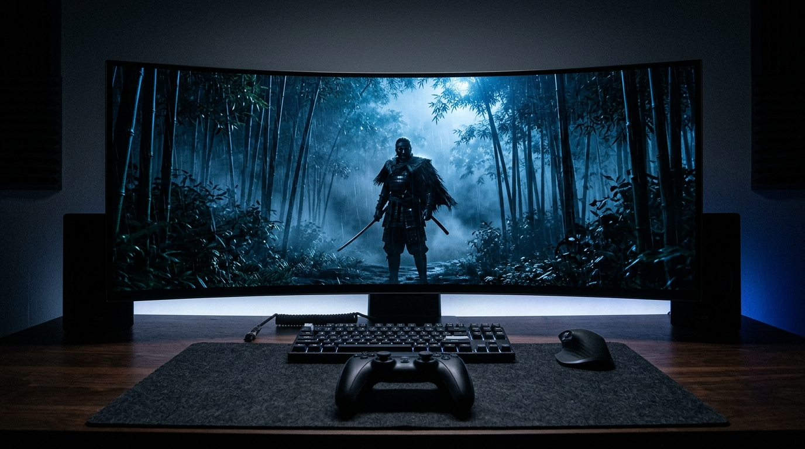
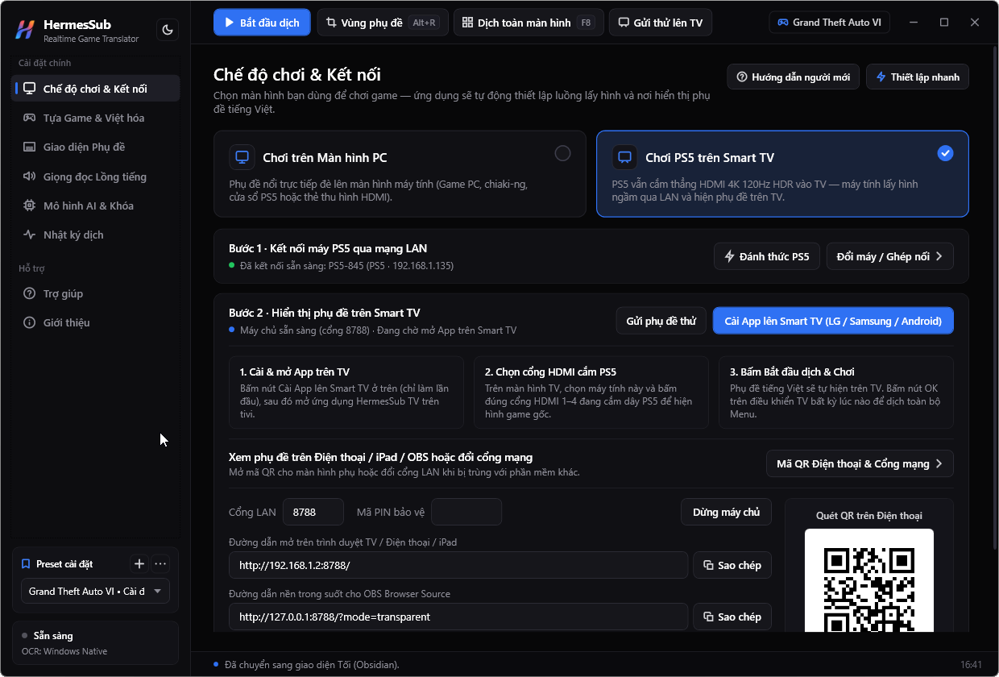
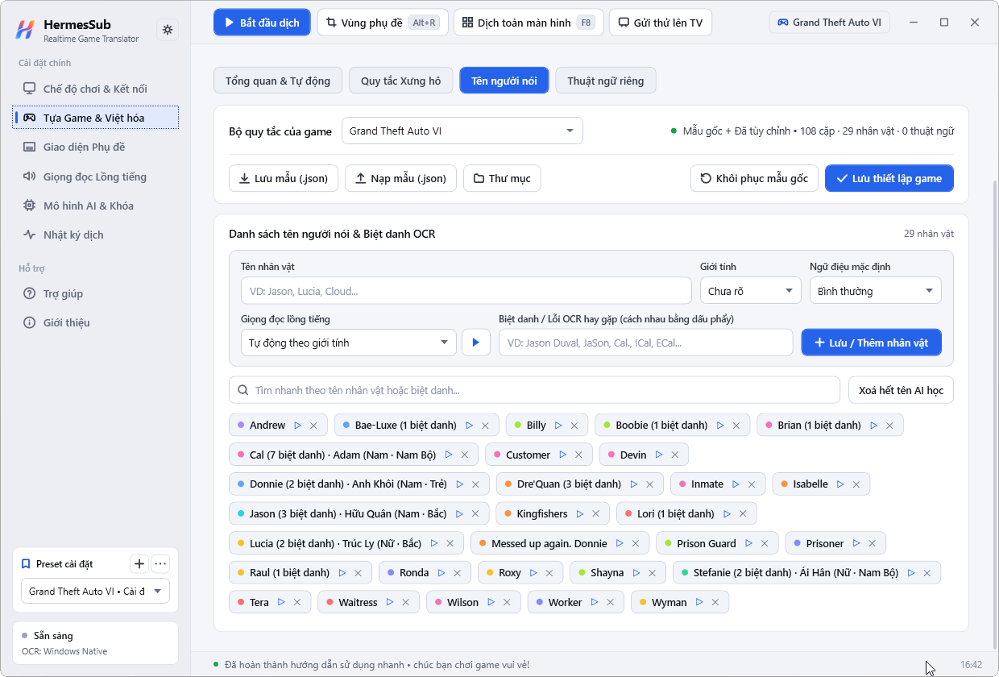

  
  <h1>HermesSub — Realtime Game Translator</h1>
  

    <strong>Hiểu trọn cốt truyện game, ngay lúc đang chơi.</strong> 
    Phụ đề và lồng tiếng tức thì theo từng nhân vật trên Windows PC, macOS và Smart TV.
  

  

    <a href="https://hermessub.github.io/"><strong>🌐 Trang chủ (hermessub.github.io)</strong></a>
    &nbsp;•&nbsp;
    <a href="https://github.com/HermesSub/hermessub.github.io/releases/latest"><strong>⬇️ Tải bản mới nhất (Releases)</strong></a>
  

---

  

## Tính năng nổi bật

- **Dịch phụ đề tức thì trong lúc chơi:** Nhận diện hội thoại trực tiếp trên màn hình và hiển thị phụ đề khớp từng câu thoại, không cần dừng game hay tra từ điển.
- **Giữ đúng xưng hô & sắc thái nhân vật:** Hiểu ngữ cảnh cốt truyện, phân biệt quan hệ giữa các nhân vật (anh–em, ngươi–ta, thầy–trò...) và ghi nhớ thuật ngữ riêng của từng game.
- **Lồng tiếng nhiều vai (Multi-Voice Acting):** Gán giọng đọc riêng biệt cho từng nhân vật, tách bạch lời dẫn chuyện và hội thoại.
- **Chơi đa nền tảng (PC, macOS & PS5 / Smart TV):** Hỗ trợ chơi trực tiếp trên máy tính hoặc kết nối bridge hiển thị phụ đề mượt mà ngay trên TV phòng khách.
- **Tùy biến giao diện phụ đề linh hoạt:** Chọn nhanh phong cách phụ đề (Cinema, Soft, Minimal), cỡ chữ, vị trí và độ trong suốt theo sở thích.

## Tải về & Cài đặt

1. Truy cập mục **[Releases mới nhất](https://github.com/HermesSub/hermessub.github.io/releases/latest)**.
2. Tải bản phát hành tương ứng với hệ điều hành của bạn (**Windows x64** hoặc **macOS**).
3. Giải nén (hoặc chạy trình cài đặt) và mở **HermesSub**, làm theo hướng dẫn thiết lập nhanh ngay lần đầu mở app.

> Xem thêm ảnh chụp giao diện và video demo trực tiếp tại **[https://hermessub.github.io/](https://hermessub.github.io/)**.

## Ảnh chụp màn hình

| Chế độ PC Overlay | Xưng hô & Ngữ cảnh nhân vật |
| :---: | :---: |
|  |  |

---

  © HermesSub — <a href="https://hermessub.github.io/">https://hermessub.github.io/</a>

